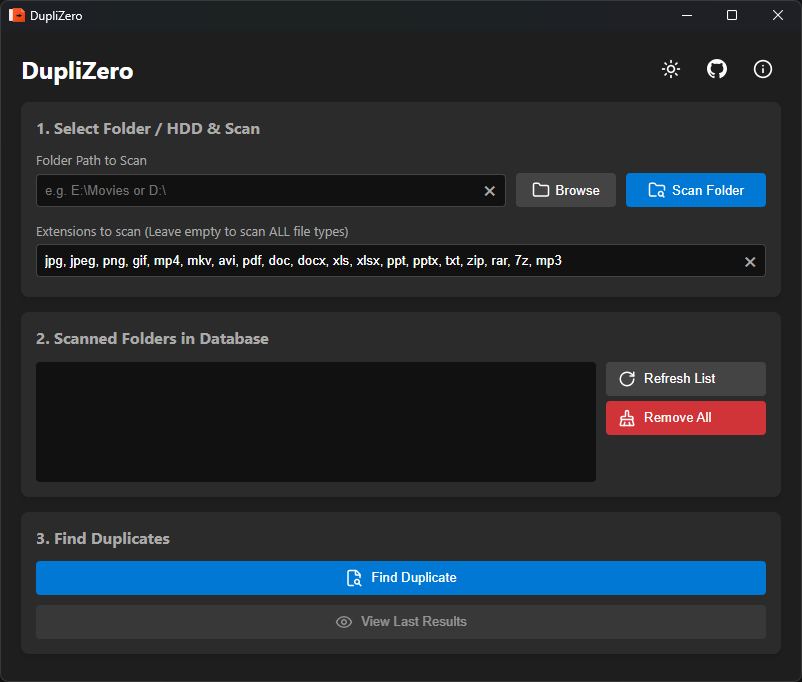
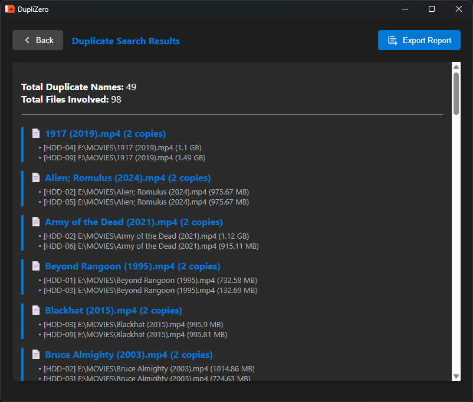

<div align="center">
  <!-- App Logo -->
  

  # DupliZero
  
  **A fast and efficient tool to scan your drives and find duplicate files across multiple folders or HDDs.**


  [](https://www.rust-lang.org/)
  [](https://tauri.app/)
  [](https://www.typescriptlang.org/)
  [](https://www.sqlite.org/)

 **[English]** | [မြန်မာ](README.mm.md)
  <br />

  [Features](#-features) • [Screenshots](#-screenshots) • [Installation](#-installation) • [Support](#-support--donate)
</div>

---

## 📖 About DupliZero

**DupliZero** is a lightweight, blazing-fast duplicate file finder built with **Rust** and **Tauri**. Unlike other tools, it doesn't just scan your files—it builds a secure offline database (SQLite) of your files, allowing you to scan multiple external HDDs one at a time and find duplicates across all of them effortlessly.

Powered by Rust, it ensures high performance with minimal memory usage, keeping your storage organized and clutter-free.

---

## ✨ Features

- 🚀 **Blazing Fast Performance:** Powered by Rust for quick scanning and searching.
- 💾 **Offline Database (SQLite):** Save scanned file lists locally and query them anytime.
- 🔍 **Smart Duplicate Finder:** Find files with identical names across different drives.
- 📂 **Custom Extensions:** Filter scans by specific file types (e.g., `.mp4`, `.jpg`, `.pdf`).
- 🎨 **Modern UI:** Clean, responsive interface with Dark/Light mode support.
- 📊 **Detailed Reports:** View summary and export duplicate results to a `.txt` file.
- 🔒 **Privacy First:** 100% offline. No data is ever sent to the internet.

---

## 📸 Screenshots

<div align="center">
  
  <br />
  <em>Main Interface - Scanning and Database Management</em>
  <br /><br />
  
  <br />
  <em>Search Results - View and Export Duplicates</em>
</div>

---

## 🛠️ Tech Stack

- **Frontend:** HTML, CSS, TypeScript (Vanilla)
- **Backend:** Rust (Tauri)
- **Database:** SQLite (via `rusqlite`)

---

## 🚀 Installation & Development

### Prerequisites
Make sure you have [Node.js](https://nodejs.org/) and [Rust](https://rustup.rs/) installed on your system.

### Clone the repository
```bash
git clone https://github.com/YawStar/DupliZero.git
cd DupliZero
```

### Install dependencies
```bash
npm install
```

### Run in development mode
```bash
npm run tauri dev
```

### Build for production
```bash
npm run tauri build
```
*(The `.exe` or installer will be generated in `src-tauri/target/release/bundle/`)*

---

## ❤️ Support & Donate

If you find **DupliZero** useful and want to support its development, consider buying me a coffee! Your support means a lot.

<div align="center">
  <a href="https://yawstardancebox.github.io/donate/" target="_blank">
    
  </a>
</div>

---

## 📄 License

This project is licensed under the **MIT License**. See the [LICENSE](LICENSE) file for details.

```text
MIT License

Copyright (c) 2026 YawHackka (YawStar)

Permission is hereby granted, free of charge, to any person obtaining a copy
of this software and associated documentation files (the "Software"), to deal
in the Software without restriction, including without limitation the rights
to use, copy, modify, merge, publish, distribute, sublicense, and/or sell
copies of the Software, and to permit persons to whom the Software is
furnished to do so, subject to the following conditions:

The above copyright notice and this permission notice shall be included in all
copies or substantial portions of the Software.

THE SOFTWARE IS PROVIDED "AS IS", WITHOUT WARRANTY OF ANY KIND, EXPRESS OR
IMPLIED, INCLUDING BUT NOT LIMITED TO THE WARRANTIES OF MERCHANTABILITY,
FITNESS FOR A PARTICULAR PURPOSE AND NONINFRINGEMENT. IN NO EVENT SHALL THE
AUTHORS OR COPYRIGHT HOLDERS BE LIABLE FOR ANY CLAIM, DAMAGES OR OTHER
LIABILITY, WHETHER IN AN ACTION OF CONTRACT, TORT OR OTHERWISE, ARISING FROM,
OUT OF OR IN CONNECTION WITH THE SOFTWARE OR THE USE OR OTHER DEALINGS IN THE
SOFTWARE.
```

---

## 👨‍💻 Developer

**YawHackka**  
*Organization: YawStar*

- GitHub: [@YawStar](https://github.com/YawStar)
- Repository: [DupliZero](https://github.com/YawStar/DupliZero)

---
<div align="center">
  <sub>Built with ❤️ using Tauri + Rust</sub>
</div>
