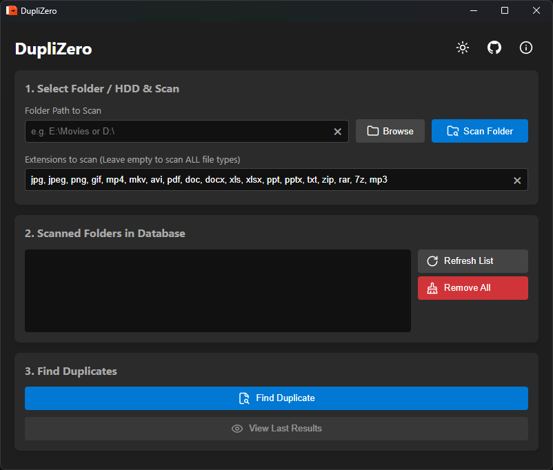
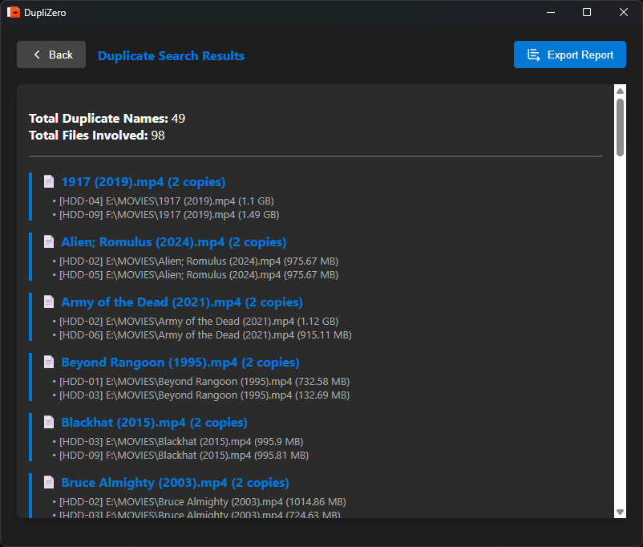

<div align="center">
  <!-- App Logo -->
  

  # DupliZero
  
  **ကွန်ပျူတာ သို့မဟုတ် External HDD များထဲမှ ထပ်နေသော (Duplicate) ဖိုင်များကို အမြန်ဆုံး ရှာဖွေပေးနိုင်သည့် စွမ်းဆောင်ရည်မြင့် Tool တစ်ခုဖြစ်ပါသည်။**


  [](https://www.rust-lang.org/)
  [](https://tauri.app/)
  [](https://www.typescriptlang.org/)
  [](https://www.sqlite.org/)

 [English](README.md) | **[မြန်မာ]**
  <br />

  [အင်္ဂါရပ်များ](#-အင်္ဂါရပ်များ) • [Screenshots](#-screenshots) • [ထည့်သွင်းနည်း](#-ထည့်သွင်းနည်း-နှင့်-အသုံးပြုနည်း) • [ပံ့ပိုးကူညီရန်](#-ပံ့ပိုးကူညီရန်)
</div>

---

## 📖 DupliZero အကြောင်း

**DupliZero** သည် **Rust** နှင့် **Tauri** ကို အသုံးပြုပြီး ဖန်တီးထားသော ပေါ့ပါးပြီး အလွန်မြန်ဆန်သည့် Duplicate File Finder တစ်ခု ဖြစ်ပါသည်။ အခြားသော Tool များနှင့် မတူညီသည့်အချက်က ဖိုင်များကို Scan ဖတ်ရုံသာမက သင့်ကွန်ပျူတာထဲတွင် လုံခြုံသော Offline Database (SQLite) တစ်ခုကို တည်ဆောက်ပေးထားခြင်း ဖြစ်သည်။ ထို့ကြောင့် External HDD များကို တစ်ခုချင်းစီ တပ်ပြီး Scan ဖတ်ထားခြင်းဖြင့် နောက်ပိုင်းတွင် ၎င်း HDD များအားလုံးထဲမှ ထပ်နေသောဖိုင်များကို အလွယ်တကူ ရှာဖွေနိုင်မည် ဖြစ်သည်။

Rust ၏ စွမ်းဆောင်ရည်ကြောင့် Memory သုံးစွဲမှု နည်းပါးပြီး အလွန်မြန်ဆန်စွာ အလုပ်လုပ်ဆောင်ပေးနိုင်သောကြောင့် သင့် Storage ကို သပ်ရပ်စွာ စီမံခန့်ခွဲနိုင်မည် ဖြစ်သည်။

---

## ✨ အင်္ဂါရပ်များ

- 🚀 **အလွန်မြန်ဆန်ခြင်း:** Rust ကို အသုံးပြုထားသောကြောင့် Scan ဖတ်ခြင်းနှင့် ရှာဖွေခြင်းများ အလွန်မြန်ဆန်ပါသည်။
- 💾 **Offline Database (SQLite):** Scan ဖတ်ထားသော ဖိုင်စာရင်းများကို သင့်စက်ထဲတွင်ပဲ သိမ်းဆည်းထားနိုင်ပြီး အချိန်မရွေး ပြန်လည်ရှာဖွေနိုင်ပါသည်။
- 🔍 **Smart Duplicate Finder:** မတူညီသော Drive များထဲမှ နာမည်တူဖိုင်များကို ရှာဖွေပေးပါသည်။
- 📂 **Custom Extensions:** လိုချင်သော ဖိုင်အမျိုးအစားများ (ဥပမာ - `.mp4`, `.jpg`, `.pdf`) ကို ရွေးချယ်၍ Scan ဖတ်နိုင်ပါသည်။
- 🎨 **Modern UI:** Dark/Light Mode ပါဝင်သော ခေတ်မီပြီး သန့်ရှင်းသည့် Interface ကို ရရှိမည်ဖြစ်သည်။
- 📊 **Detailed Reports:** ရှာဖွေတွေ့ရှိမှု အနှစ်ချုပ်ကို ကြည့်ရှုနိုင်ပြီး `.txt` ဖိုင်အနေဖြင့် Export ထုတ်နိုင်ပါသည်။
- 🔒 **Privacy First:** 100% Offline ဖြစ်ပါသည်။ သင့်ဒေတာများကို အင်တာနက်ပေါ်သို့ လုံးဝ ပေးပို့ခြင်း မရှိပါ။

---

## 📸 Screenshots

<div align="center">
  
  <br />
  <em>Main Interface - Scan ဖတ်ခြင်းနှင့် Database စီမံခန့်ခွဲမှု</em>
  <br /><br />
  
  <br />
  <em>Search Results - ရှာဖွေတွေ့ရှိမှုများကို ကြည့်ရှုခြင်းနှင့် Export ထုတ်ခြင်း</em>
</div>

---

## 🛠️ အသုံးပြုထားသော နည်းပညာများ

- **Frontend:** HTML, CSS, TypeScript (Vanilla)
- **Backend:** Rust (Tauri)
- **Database:** SQLite (via `rusqlite`)

---

## 🚀 ထည့်သွင်းနည်း နှင့် အသုံးပြုနည်း

### လိုအပ်ချက်များ
သင့်ကွန်ပျူတာတွင် [Node.js](https://nodejs.org/) နှင့် [Rust](https://rustup.rs/) တို့ ထည့်သွင်းထားရန် လိုအပ်ပါသည်။

### Repository ကို Clone လုပ်ခြင်း
```bash
git clone https://github.com/YawStar/DupliZero.git
cd DupliZero
```

### Dependencies များ ထည့်သွင်းခြင်း
```bash
npm install
```

### Development Mode ဖြင့် Run ခြင်း
```bash
npm run tauri dev
```

### Production အတွက် Build လုပ်ခြင်း
```bash
npm run tauri build
```
*(ထွက်ရှိလာမည့် `.exe` သို့မဟုတ် Installer ကို `src-tauri/target/release/bundle/` အောက်တွင် ရှာတွေ့နိုင်ပါသည်)*

---

## ❤️ ပံ့ပိုးကူညီရန်

**DupliZero** ကို အသုံးဝင်တယ်လို့ ခံစားရပြီး ဖွံ့ဖြိုးတိုးတက်ရေးအတွက် ပံ့ပိုးကူညီလိုပါက အောက်ပါ Link မှတဆင့် ကူညီနိုင်ပါသည်။ သင့်ရဲ့ ပံ့ပိုးမှုက အများကြီး တန်ဖိုးရှိပါတယ်။

<div align="center">
  <a href="https://yawstardancebox.github.io/donate/" target="_blank">
    
  </a>
</div>

---

## 📄 လိုင်စင် (License)

ဤ Project ကို **MIT License** အောက်တွင် ဖြန့်ဝေထားပါသည်။ အသေးစိတ်ကို [LICENSE](LICENSE) ဖိုင်တွင် ကြည့်ရှုနိုင်ပါသည်။

```text
MIT License

Copyright (c) 2026 YawHackka (YawStar)

Permission is hereby granted, free of charge, to any person obtaining a copy
of this software and associated documentation files (the "Software"), to deal
in the Software without restriction, including without limitation the rights
to use, copy, modify, merge, publish, distribute, sublicense, and/or sell
copies of the Software, and to permit persons to whom the Software is
furnished to do so, subject to the following conditions:

The above copyright notice and this permission notice shall be included in all
copies or substantial portions of the Software.

THE SOFTWARE IS PROVIDED "AS IS", WITHOUT WARRANTY OF ANY KIND, EXPRESS OR
IMPLIED, INCLUDING BUT NOT LIMITED TO THE WARRANTIES OF MERCHANTABILITY,
FITNESS FOR A PARTICULAR PURPOSE AND NONINFRINGEMENT. IN NO EVENT SHALL THE
AUTHORS OR COPYRIGHT HOLDERS BE LIABLE FOR ANY CLAIM, DAMAGES OR OTHER
LIABILITY, WHETHER IN AN ACTION OF CONTRACT, TORT OR OTHERWISE, ARISING FROM,
OUT OF OR IN CONNECTION WITH THE SOFTWARE OR THE USE OR OTHER DEALINGS IN THE
SOFTWARE.
```

---

## 👨‍💻 ဖန်တီးသူ

**YawHackka**  
*Organization: YawStar*

- GitHub: [@YawStar](https://github.com/YawStar)
- Repository: [DupliZero](https://github.com/YawStar/DupliZero)

---
<div align="center">
  <sub>❤️ ဖြင့် Tauri + Rust ကို အသုံးပြုပြီး ဖန်တီးထားပါသည်</sub>
</div>
